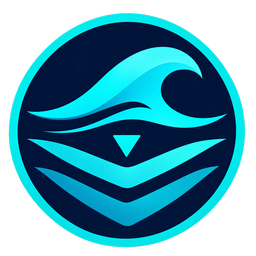

# Bathys Web

Godot 4.7.2, typed GDScript, Compatibility renderer. This project exports with the **standard Godot editor**, without .NET or Godot C# support. It is educational software only and must not be used for real dive decisions. The app displays its warning and © swisstopo SWISSIMAGE attribution.

## Run and test

Open this directory in standard Godot 4.7.2, then run `Main.tscn`. The Web export preset writes `WebBuild/index.html`; serve `WebBuild` over HTTP to test the exported app in a browser. For command line use, substitute your standard Godot 4.7.2 executable:

```powershell
godot --headless --editor --path . --quit
godot --headless --path . --script Tests/Reference.gd
godot --headless --path . --script Tests/UiSmoke.gd
godot --headless --path . --script Tests/Responsiveness.gd
godot --headless --path . --export-release Web WebBuild/index.html
python -m http.server 8765 --bind 127.0.0.1 --directory WebBuild
```

The Web preset does not package `Tools` or `Tests`. `Data/survey_grid.dat` is explicitly included. The source app in `../bathys` remains independent and runnable.

## Data and persistence

Packaged site JSON, satellite imagery, survey grid, bathymetry, and terrain tiles load from `res://`. The grid stores raw measured elevations and separately flagged interpolated small gap values; the rendered mesh uses the same display smoothing as the C# reference. The web app does not parse the full survey CSV or build the terrain and overlay pixel by pixel on launch.

Plans persist in `user://plan.json`. Packaged POIs are read only. **SAVE** downloads a plan JSON file and keeps a backup in local `user://` storage. **LOAD** opens a plan file or the saved backup on this device. **EXPORT** downloads the current 2D or 3D map view as a JPG, with source attribution. The gear opens gas-limit settings; these are included in plan files and remembered as defaults for new scenarios on this device.

Offline data preparation, when the source survey changes:

```powershell
dotnet run --project Tools/PrepareGrid.csproj
python Tools/prepare_overlay.py
godot --headless --path . --script Tools/PrepareTerrain.gd
```

The first command links C# reference source as a **build tool only**. Its outputs are packaged data; it is never needed by the exported app.

## UI

The left column shows cylinder SPGs and gas metrics. The right tabs edit the route and environment, show environment and decompression settings, and display tissues. Physiology starts with Depth; the **+** menu adds optional readouts. Value and unit share one row in compact cards. Drag the dividers beside the map to resize the tanks and route panels. Drag to the outer edge to collapse a panel, and drag inward from the remaining handle to restore it. Settings includes default SAC and swim speed for newly created route events. Click a POI or surveyed bed to inspect it, then choose **Add waypoint**. Always-visible **+** controls between route cards insert holds and gas switches. Drag any non-editable area of a route card to reorder it; an insertion line shows the destination. The list scrolls near its edges during a drag. Undo/redo and Alt+Up/Down on a focused card remain available. The lower timeline seeks or plays the simulation and switches among depth, TTS, NDL, CNS, and OTU plots. The 3D view loads on demand and supports orbit, pan, zoom, and terrain picking.

See [MIGRATION.md](MIGRATION.md) for the milestone record, numerical comparison, and browser measurements.


## Languages

English is the default. Use the flag in the header to select **English** or **Français**. The app remembers the chosen language on this device. Language changes preserve the current plan and playback; user-entered names are kept as written. French translations are maintained in `Data/i18n/fr.json`, with local SVG flag assets. Translation templates retain the English format placeholders.


## Interactive lessons

The icon switch in the header changes between the map workspace and the learning workspace (open-book icon). The map opens by default. Entering a lesson pauses playback; switching back preserves the scenario, time, map view, panel visibility and undo history. Scenario file actions are hidden while learning, and the language selector remains available.

Choose a topic in the left navigation:

- **Boyle’s law:** change depth with the slider, depth presets, or by dragging in the water diagram. A fixed gas sample shrinks under increasing absolute pressure, alongside a linked pressure–volume curve and live readouts. The simplified example starts with 1 L at 1 bar absolute and adds 1 bar per 10 m. Temperature and gas amount remain constant; bubble radius scales with the cube root of volume. This sea-level example is separate from the lake’s pressure/density model.
- **Snell’s law:** adjust incidence with the slider or drag in the incoming medium. Switch air → water / water → air to explore bending toward/away from the normal, the critical angle and total internal reflection. Uses n = 1.000 / 1.333, a flat boundary and angles measured from the normal. Partial reflection below the critical angle is omitted.

Both lessons support English/French, keyboard slider controls and narrow layouts. Experiment settings survive topic/workspace/language changes for the current session. Run `godot --headless --path . --script Tests/LearningUi.gd`; add `-- --visual` without `--headless` to record rendered screenshots.

References: [NASA: Boyle’s law](https://www.grc.nasa.gov/www/BGH/boyle.html), [OpenStax: total internal reflection and Snell’s window](https://openstax.org/books/university-physics-volume-3/pages/1-4-total-internal-reflection), [Divers Alert Network: lung expansion](https://dan.org/alert-diver/article/lung-expansion-injuries/).
